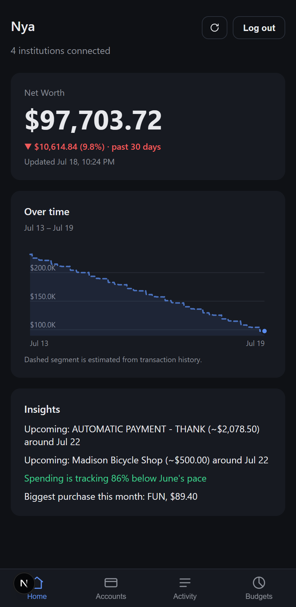
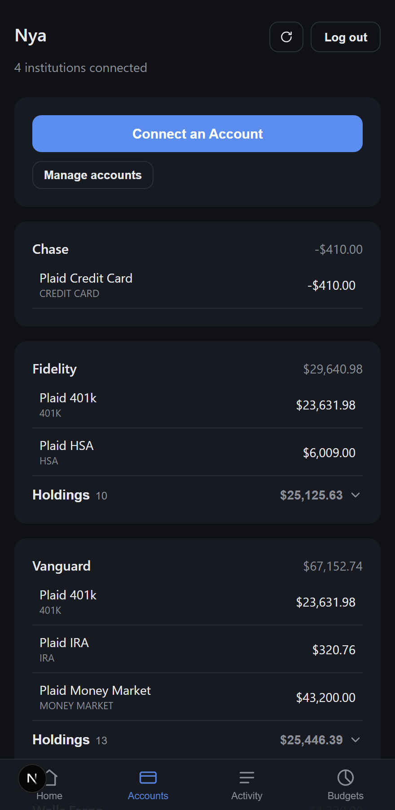
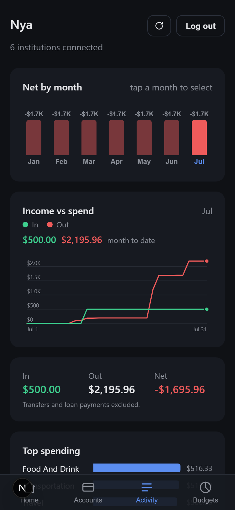
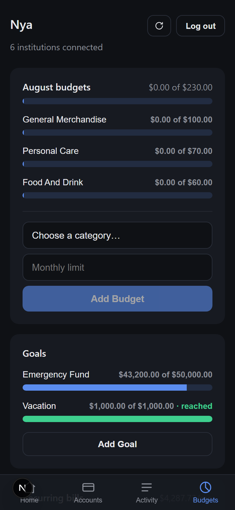
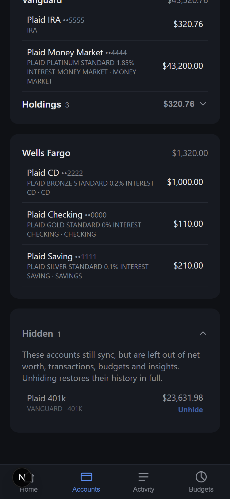
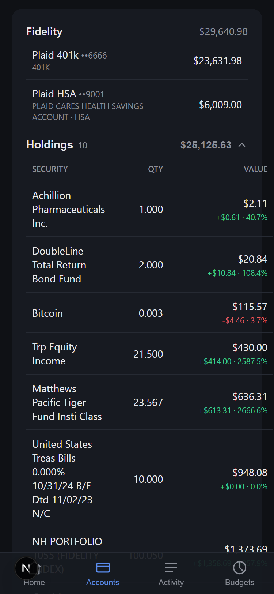
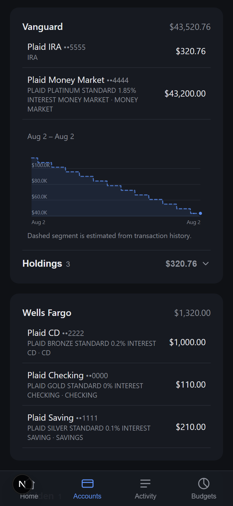
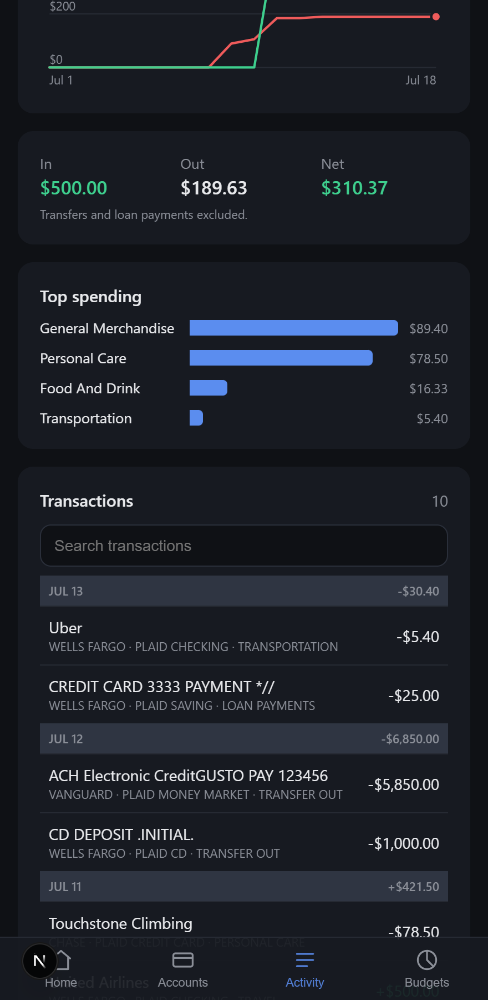
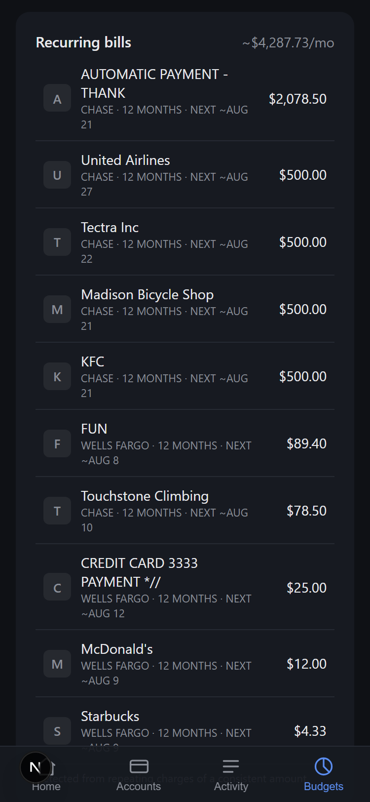

# Nya


A personal finance tracker built with Next.js and React. It connects to your financial accounts at US institutions through Plaid (banks, credit cards, loans, brokerages and retirement accounts such as 401(k)s), and to banks Plaid doesn't reach through your own SimpleFIN or Lunch Flow account, and keeps a running net worth, a year of transactions, budgets and savings goals, and works out when you could be financially independent and how a retirement would have lasted. It runs on Bun, deploys to Vercel, encrypts your financial data before storing it in Upstash Redis (dates, ids and a few names stay plain text; see [Architecture](docs/architecture.md#storage-and-encryption)), and installs on your phone as a PWA.

**[Try the live demo](https://nya-git-preview-fueroberthers-projects.vercel.app/?_vercel_share=hsOPuA6Qvofd4jxnrQVjuqXhPVkNqykh)** and sign in with one of the two **demo accounts** (Alex or Sam). It runs against Plaid's sandbox on its own database, so every account and balance you see there is fake. Everyone who tries the demo shares those accounts, so anything you add is visible to other visitors. See [Demo accounts](docs/authentication.md#demo-accounts) and [Preview deployments](docs/deployment.md#preview-deployments) for how it is wired.

## What it does

Five tabs, mobile-first, with bottom navigation:

- **Home**: net worth with a 30-day delta and a scrubbable over-time chart (daily snapshots plus an estimated backfill), with **notes on the timeline** that mark a day's step (an account that closed, a house bought; add your own), insights and alerts (a bank connection about to end, budgets over or approaching their limit, low balances, uninvested cash sitting in a brokerage, upcoming recurring bills and payments due, spending pace against last month, and the biggest purchase), and with them one FI line with the Plan's years to FI and progress, its FI number and your savings rate over the last year (estimates, labelled as such, from the same figures as the Plan tab). When a bank can't be reached, the notes under the total name it and say when it was last seen.
- **Accounts**: a per-institution balance sheet. Tap an account for its own balance history. Holdings show gain or loss against cost basis, and money that isn't actually invested (a settlement fund, a sweep account) is marked and flagged once it is large enough to be worth placing. Credit cards and loans show their APR, minimum payment and due date, and a **payoff plan** works out when they're paid off and the interest that costs, highest rate first (avalanche) or smallest balance first (snowball), against paying only the minimums. Investment accounts show the last year of activity and this year's contributions, with rollovers counted separately from money saved, and their holdings are recorded each day Nya can fetch them, since Plaid keeps no history of them. Two ways to connect through Plaid: **Connect a bank or card**, and, where the deployment turns it on, **Connect a brokerage or retirement account** for 401(k)s, IRAs and brokerages, including ones the bank option can't find. **Connect with SimpleFIN** brings your own sync: paste a one-time Setup Token from your own SimpleFIN account (about $15 a year, paid to SimpleFIN; Redbark, a separate paid service for Australia and New Zealand, works the same way), choose which of its accounts to track, and they count everywhere an account does, fetched daily, labelled **via SimpleFIN**, with SimpleFIN's own words when something breaks, and kept as manual accounts if you disconnect. A card or loan it reports as money held isn't counted until you say which way it goes, and a balance the bank gave days ago isn't recorded as today's. Where the deployment turns it on (`LUNCHFLOW_ENABLED=1`), **Connect with Lunch Flow** works the same way with an API key from your own Lunch Flow account (about $35 a year for two bank connections, paid to Lunch Flow), which reaches banks in many countries through providers such as GoCardless and Akahu: it brings balances and posted transactions, no pending ones, holdings or categories, and each balance says the day Nya received it, since Lunch Flow gives none. Any account can be **hidden** (still syncing, no longer counted), and institutions Plaid can't reach can be tracked as **manual accounts**. A linked account can **import its history from a file** its bank lets you download (OFX or QFX, CSV, QIF), years further back than the bank shares with Plaid: a review shows each likely duplicate beside the bank's own row (or an earlier file's) and merges nothing without your answer, the rows count everywhere transactions do, a later sync's rows take their place, the net-worth chart's estimate reaches back through them (only across the days the files cover, and saying what it can't join up), and one step undoes it exactly. An account can also **end**: closed, no longer yours, or no longer followed, from a day, which leaves every day before it as it was and stops it counting from then on, everywhere; nothing is deleted, so reopening restores it exactly (one its bank no longer returns is held at its last known balance until it does). When a bank stops returning an account, or one sits at zero for weeks, Nya asks whether it closed instead of guessing, and holds a missing one at its last known balance until you answer (see [Accounts that end](docs/features.md#accounts-that-end)). **Connection health** is on each institution's card: its state, when it last synced, whose side a problem is on and what to do (reconnect, wait, or remove and connect again), and a connection Plaid says will end shows **Reconnect soon** with the date.
- **Activity**: twelve months of transactions with a monthly breakdown (trend columns, money in, out and net, top spending by category group) and search. A **cash flow** chart shows where money came from and where it went over this month, last month, the last 3 or 12 months or the year to date, as a Sankey diagram: who paid you, flowing into your category groups and their categories, with what was left over or came from savings or debt, counted exactly as the totals are, with a table of every flow; tap any part to list its transactions ([Cash flow](docs/features.md#cash-flow)). Recategorize a transaction or rename a vendor; both are manual overrides that persist, and a rename applies to every transaction from that merchant. **Categories and groups** are your own: rename, regroup, archive, merge or delete them in Settings (the account menu, or the gear in password mode), and every transaction, total and budget follows, or start from a **starter set** (Simple, Detailed or Freelancer), which shows what it would change before it does and can be undone ([Categories and groups](docs/features.md#categories-and-groups)). Transfers and loan payments are left out of the totals (a bank's fees count as spending), and a pending charge is de-duplicated against its posted version. **Add a transaction** by hand (cash, a bank Plaid can't reach) to a manual account, in its own currency, from a quick form built for a phone; it counts like a bank's, is saved once however often a flaky connection sends it, and moves the account's typed balance only if you ask. **Import a file** your bank exports (OFX or QFX, CSV with your own column mapping, QIF) into a manual account: a preview shows what is new, what is already there and any line that can't be read, importing the same file again adds nothing, and an import can be undone in one step. **Switching from another app**: bring your history from Monarch, YNAB, Lunch Money, Actual Budget or ZeroSum from the export each app gives you, told by its columns: each of its accounts goes where you say (a new manual account, one you have, or a linked account, matched against the bank's own rows so nothing counts twice), its categories map to yours by name or come in as new ones of the kind the app gave them, transfers between your accounts stay out of spending, and its tags, notes and split transactions come with them, all through one review and undone in one step ([Switching from another app](docs/features.md#switching-from-another-app)). Any posted transaction can be **excluded from budgets and reports** (a one-off): it stays listed, marked, and drops out of every total, its day's subtotal included, and stays excluded across a reconnect once the new account is linked to the old. **Tags and notes**: any transaction can carry several tags ("reimbursable", "vacation 2026") and a note, shown on its row, found by the search, filtered by tag, and totalled as **spending by tag**, which agrees with the category totals ([Tags and notes](docs/features.md#tags-and-notes)). **Rules** file, rename, tag or hide every transaction that matches them, past and future, applied as transactions are read, so turning one off puts them back; a choice you make on one transaction always wins. Make one in Settings, or from a transaction (**Create a rule from this**), with a preview of how many it matches before you save ([Rules](docs/features.md#rules)). **Split** a transaction into parts, each under its own category (one Costco charge as groceries, household things and a tire), or **group** transactions that belong together (a dinner and what a friend paid you back) so they count once, at their net: every total counts the parts and the net, never twice, and the transaction stays one row as the bank has it, its parts or the group's transactions beneath ([Splitting a transaction](docs/features.md#splitting-a-transaction), [Grouping transactions](docs/features.md#grouping-transactions)). **Shared expenses** keep track of what people owe you and what you owe them: share the cost of a transaction (half, evenly or by amount) or add an IOU, and your totals count your part, never a friend's part as your spending nor their paying you back as income. **Ask for it** opens Venmo with the request filled in, or gives a message to copy for Cash App or anything else; when the money reaches one of your accounts, the card offers to mark it paid back, and nothing is marked until you confirm. Nya never sends, receives or holds money ([Shared expenses](docs/features.md#shared-expenses)). Turn on the **review queue** and new transactions wait for you to approve them: one at a time in a swipe **Card Mode** (approve, recategorize, skip, split or group, with an undo and keys on a desktop), or everything listed at once, with how many and an undo; an approved transaction keeps the category you approved it under, whatever a later rule, default or the bank says, which is offered instead, and a new amount from the bank puts it back in the queue, still under that category ([Reviewing new transactions](docs/features.md#reviewing-new-transactions)). Give a merchant's transactions the same category two times out of three and it becomes the merchant's **default**, filing its new transactions under your rules and your own choices, listed and cleared in Settings ([Merchant defaults](docs/features.md#merchant-defaults)). A month whose transactions may be incomplete, because a bank couldn't be read or stopped syncing before it ended, says so under its totals. Where the deployment turns it on, attach **receipts and documents** to any transaction: a photo made smaller and stripped of its location in your browser, or a PDF, encrypted before it is stored; a paperclip marks the transaction, a filter finds those without one over an amount, a list in Settings holds them all, and they download as ZIP files. Never shared, never in the API ([Receipts and documents](docs/features.md#receipts-and-documents)).
- **Budgets**: monthly budgets per category or per category group with severity meters, each of which can **roll over** what is left, or overspent, into the next month, worked out from your transactions so a recategorized past month changes it at once, with any month that may be incomplete named; a **suggestion** for each from what was spent there on average over the last three complete months, saying which months it counted, with one tap to use it; a month picker to look back at past months as they were; for income that doesn't arrive every month, an optional **income carryover** (off by default) that shows what is available to allocate; and **savings goals** tracked against an account's balance: each can set part of it aside (an allocation, so goals on one account never count more than it holds, with what is left unallocated shown), take a monthly target and a target date, says when it will be reached at the pace money went in over the last three months (or that nothing did), how far short of its date it is, and marks where it should be by now; goals reached are archived with their history. See [Savings goals](docs/features.md#savings-goals). See [Budget rollover and income carryover](docs/features.md#budget-rollover-and-income-carryover). Recurring bills and income are detected on their cadence, from weekly to yearly, on each account, each with how often it was seen and its next date, and one can be marked not recurring. A **cash forecast** carries your checking and savings, less what is still pending, over the next 30, 60 or 90 days through the bills and income on them and the expenses and income you plan, with its lowest point and a warning, and a **what-if** shows one purchase's effect. A **calendar** shows what posted each day and what is expected, with card payments due. See [Recurring bills and the cash forecast](docs/features.md#recurring-bills-and-the-cash-forecast).
- **Plan**: financial independence from your own data. The FI number, years to FI, Coast FI and Barista FI, from your last year of spending (mortgage, car, student and personal loan payments and cash included), your invested assets and an estimate of your savings (workplace plan contributions included). Each input is labelled with its dates and anything that may be missing from it, and can be typed over. A retirement simulator runs historical cycles on monthly US data since 1871, or a seeded Monte Carlo, with five withdrawal rules (constant, percent of portfolio, Guyton-Klinger guardrails, VPW, floor and ceiling), other income, one-off expenses, fees and a flat tax. It shows the success rate with its definition (and, for a rule that cuts spending, how far it fell), a fan chart, the worst starting years, a grid by withdrawal rate and length, and every assumption beside the result. **Scenarios** keep what-ifs beside the plan (a retirement age, a spending figure, a home, a child, a sabbatical, part-time work), each only what it changes, opened in place to see and change them, and **compare** two to four plans side by side on the same history and seed: what each starts with and would have then, how often it lasted, the ending balance, the FI date and spending. **Allocation** shows your investment accounts by asset class and by tax bucket, from the account's type, the security's type and a hand-checked list of broad index funds, with your own splits and buckets winning and anything else shown as unclassified, never guessed; drift against a target you set; the mix over time from recorded holdings; and the simulation's stock, bond and cash mix taken from it when you confirm, with what was left out named. See [Planning](docs/features.md#planning).

Amounts are shown in the currency they carry. Choose a **home currency** (Home offers it when your accounts and transactions are in more than one; nothing changes until you do) and your net worth, its change and its chart are shown in it, converted at the European Central Bank's daily reference rates or rates of your own (a cryptocurrency's, say), each day at its own rate, saying what was converted and leaving out, by name, a currency with no rate ([A home currency](docs/features.md#a-home-currency)). Nothing converted is ever stored. Totals of transactions (the month's totals and its day subtotals, budgets, recurring bills, the Home insights, the Plan) add up only the currency most of your transactions are in and say how many in other currencies they left out; a transaction with no currency code, which only the oldest stored history has, counts as that currency. Without a home currency, net worth is labelled with your most common currency and says so when your accounts mix currencies. The header's refresh button bypasses the cache and re-reads from Plaid.

**Hide amounts**, the eye in the header, shows the app's structure while hiding its figures, for using Nya in public, on a shared screen or in a screenshot: every amount on screen reads "$•••" and every field holding one shows the same mask, while meters, bars, charts and percentages keep their shapes, and a screen reader hears "hidden". It is remembered on the device, never on the server, and never changes the API, a download or a printed report ([Hiding amounts](docs/features.md#hiding-amounts)).

More than one person can use a deployment: sign in with Clerk and each account gets its own data, with optional read-only sharing between people who connect: you choose what each person sees (accounts one by one, your net worth, and your spending, holdings, budgets and chosen goals, each as percentages or amounts) and for how long, see exactly what they see and, before you save, what Nya knows they could work out from it all together, and both of you see each time it was shown to them. Otherwise a single shared password protects the app. See [docs/authentication.md](docs/authentication.md).

When a bank connection breaks, Nya sends one email (and one reminder a week later if it is still broken) naming the bank and what to do, never an amount, once email is set up (see [docs/deployment.md](docs/deployment.md#email-notices)).

With email set up, each person can also turn on a **weekly summary** in **Settings** (off until they do): one short plain-text email a week, on the day they pick, counted in their time zone and sent with the daily update (1 p.m. UTC: 9 a.m. in New York in summer, the first hours of the day in Sydney's summer), saying in words how the week's spending compares with a usual week, which budgets are over or close, the bills due in the next seven days, the goals reached or behind, the connections that need them and the months that may be missing transactions. It never carries a balance, an amount or an account number, links to the app for the figures, and has a link that turns it off without signing in. The card says the hour it comes in the chosen zone, shows what this week's would say before anything is sent, and can send one now (see [The weekly summary](docs/features.md#the-weekly-summary)).

Your data is yours to take: in **Settings**, **Download my data** gives you everything Nya stores about you, decrypted, as one JSON file or as CSV files of your transactions and balance history, or one bank account's or card's transactions as an OFX statement for another money app, after a fresh sign-in (see [docs/data-export.md](docs/data-export.md)). Any of them can be protected with a passphrase Nya never keeps, in the age format: it opens in the browser on the public `/open-download` page, without the file leaving the device, or with the age app. With email set up, each download emails you that it happened, never what was in it. When a record in your balance history, your manual accounts, your budgets or goals, or one of the newer stores can't be read, the file holds everything else and says what it is missing. Where the deployment turns it on, **Bring back a download** brings a JSON download into an empty account, in another copy of Nya or a new account: read and checked in the browser, everything you made comes back with its ids, a bank connected through Plaid comes back held until you connect it again and link its accounts, and it can be undone for 7 days ([Bringing it back](docs/data-export.md#bringing-it-back)). Deleting your account ends with a receipt of what was deleted, when the last backup holding it expires, and what stays with Plaid.

**Your data**, beside it in **Settings**, lists every kind of thing Nya keeps about you, from the same lists the download and the key inventory use: how many entries of each and their size, whether each is encrypted and with your account's own key or one the deployment shares, which details around them are plain text, whether the download has them, how long each is kept and who else can see it. Numbers only, never what is stored; what can't be read just now says so rather than showing nothing ([features.md](docs/features.md#your-data)). The deployment's admin also gets **Storage across accounts**: each account by its random id, with its bank connections and how they are doing, its stored transactions against the size ceiling, what it stores in all and its last snapshot, decrypting nothing: beside sizes and counts it shows only what is kept as plain text, such as banks' names and Plaid's ids ([operations.md](docs/operations.md#storage-across-accounts)).

For an accountant, **Reports** (under the Activity tab's transactions) makes a tax-year summary or a report on any dates: money in and out by category and by month, by the same rules as the Activity tab, and the categories you mark for taxes as a group with their transactions listed. Its first page says when its data is from and what it may be missing, such as a bank that stopped syncing, history that starts after the period does, a connection removed since, or an account you stopped following, and names each account that ended in the period, counted as the Activity tab counts it. Print it or save it as a PDF from the browser, or download its totals as CSV. Nya never says how anything is taxed (see [Reports](docs/features.md#reports)). Beside it, the **runway** says how long your cash (checking, savings and cash on hand) would last at your last 3, 6 or 12 months' spending, with your income and without it: the day it would run out, a chart of the cash going forward with your loan payments, bills less often than monthly and planned items on their days, the one-offs in the spending and the income named, payments to a card Nya doesn't see counted as spending, refunds taken off it, transfers out and cash taken out named, and what it can't see said first. A what-if (spending lower by an amount, income stopping on a day, planned items or one-offs left out, money moved out counted) is worked out on the page and never stored, unless you save it as a scenario ([Runway](docs/features.md#runway)). **Year over year** sets this year so far against the same days of last year, this month against the same days a year ago, and each month and each category group and category, with the change in amount and percent and the months that may be short marked ([Year over year](docs/features.md#year-over-year)). Both print like the other reports, and both are in the API.

Programs you choose can read it too: an API under `/api/v1`, and an MCP server at `/api/mcp` for AI assistants, each with a personal token you make (and revoke) in **Settings**. Where whoever runs the copy turns it on, a token made for it can also add, change and delete the transactions entered on manual accounts, and add and change manual accounts, categories and tags, each change recorded for 30 days, where you can undo it. Both serve what Nya has stored, never a live call to Plaid, with your tags, notes, rules, splits, groups, approvals and merchants' defaults applied as the app applies them, and whether each transaction waits for your review, and the public `/developers` page documents every endpoint and tool (see [The API and the MCP server](docs/features.md#the-api-and-the-mcp-server)).

Two pages anyone can open without signing in, `/security` and `/privacy`, say in plain language how the data is protected, who can read what (whoever runs the deployment included), how long things are kept, and how to delete it. Every response carries security headers, and every page a Content-Security-Policy; see [Security headers](docs/deployment.md#security-headers-and-the-content-security-policy).

## Screenshots

Captured in Plaid `sandbox` mode, so the balances and transactions are test data. Anything named "Plaid ..." is a sandbox fixture; HealthEquity and Alliant Credit Union are manual accounts added by hand. The budget meters read $0.00 because the capture was taken on the 2nd of the month, before anything had posted against them.

<table>
  <tr>
    <td align="center"><b>Home</b></td>
    <td align="center"><b>Accounts</b></td>
    <td align="center"><b>Activity</b></td>
    <td align="center"><b>Budgets</b></td>
  </tr>
  <tr>
    <td></td>
    <td></td>
    <td></td>
    <td></td>
  </tr>
</table>

On the Accounts tab, tapping any account row opens that account's own balance history and its actions (Hide and Close, plus Delete on manual accounts), Update stays on a manual account's row, each linked institution's **Options** holds Add or remove accounts and Disconnect, hidden accounts collect in their own card, accounts that ended in another, and holdings expand with gain or loss against cost basis.

<table>
  <tr>
    <td align="center"><b>Hidden</b></td>
    <td align="center"><b>Holdings</b></td>
    <td align="center"><b>Per-account history</b></td>
  </tr>
  <tr>
    <td></td>
    <td></td>
    <td></td>
  </tr>
</table>

Activity lists transactions grouped by day with a running daily net on each date heading, and Budgets lists detected recurring bills with their estimated next charge dates.

<table>
  <tr>
    <td align="center"><b>Transactions by day</b></td>
    <td align="center"><b>Recurring bills</b></td>
  </tr>
  <tr>
    <td></td>
    <td></td>
  </tr>
</table>

## Quick start

You need a [Plaid](https://dashboard.plaid.com/signup) account (the free sandbox is enough to start), a [Vercel](https://vercel.com) project, and [Bun](https://bun.sh).

1. **Get Plaid keys.** Under Team Settings > Keys, copy your `client_id` and `sandbox` secret.
2. **Create the Vercel project.** Import the repo, then add an **Upstash for Redis** database from the project's Storage tab.
3. **Set environment variables.** At minimum: `PLAID_CLIENT_ID`, `PLAID_SECRET`, `PLAID_ENV=sandbox`, `PLAID_ENCRYPTION_KEY`, `APP_PASSWORD`, `SESSION_SECRET` and `CRON_SECRET`. Generate keys and secrets with `openssl rand -base64 32`. The full list is in [docs/deployment.md](docs/deployment.md#3-environment-variables) and [`.env.example`](.env.example).
4. **Run it locally.**

   ```bash
   bun install
   vercel link
   vercel env pull .env.local
   bun run dev
   ```

   Open <http://localhost:3000>. Logging in with the shared password needs a container to exist; see [Containers](docs/operations.md#containers).
5. **Connect an account.** Log in and click **Connect a bank or card** (or, with `PLAID_BROKERAGE_LINK=1` set, **Connect a brokerage or retirement account** for a 401(k), IRA or brokerage). In sandbox mode, search for any institution and use username `user_good` and password `pass_good`.
6. **Deploy** with `vercel deploy --prod`, then install it on your phone from the browser's share or install menu.

Before you push, run `bun run typecheck && bun run test`. The tests need no Redis, Plaid keys or network.

## Documentation

| Guide | What is in it |
| --- | --- |
| [Deployment](docs/deployment.md) | Plaid and Vercel setup, every environment variable, scheduled jobs, local development, security headers and the Content-Security-Policy, preview deployments. |
| [Features in depth](docs/features.md) | Reconnecting and linking history, payment details, the debt payoff plan, hiding accounts, hiding amounts, accounts that end and notes on the timeline, unreachable institutions with connection health, Reconnect soon and email notices, manual accounts and scripted balances, bringing your own sync with SimpleFIN or Lunch Flow, importing files and importing history into a linked account, shared expenses, reports for an accountant, the runway and year over year, the weekly summary, keeping Plaid costs down, the read-only API and the MCP server, planning (the FI figures, the simulator, its data and its limits, allocation and the FI card on Home). |
| [Authentication and sharing](docs/authentication.md) | The password gate, sessions, Clerk sign-in, adding people, account deletion and its receipt, sharing, demo accounts, API tokens. |
| [Downloading your data](docs/data-export.md) | Getting everything Nya stores about you: the JSON, CSV and OFX formats field by field, what is left out, protecting a file with a passphrase and opening it, bringing a download back into an empty account, and how it differs from the operator backup. |
| [Architecture](docs/architecture.md) | Storage and encryption, the storage seam new stores are built on, caching, how net-worth history is recorded and reconstructed, accounts that end applied on read, the import pipeline and importing into a linked account, the connector interface and its guard against forged requests, containers, where hiding amounts applies, the weekly summary and its job. |
| [Design](docs/design/README.md) | The guidelines every new UI follows (enforced in part by a test), and the proposed UI reorganization: what each tab is for and what moves where, the end of Manage mode, the design system and tokens in light and dark, the rollout order, and mockups of every screen. |
| [Operations](docs/operations.md) | Backups and restores, encryption key setup and rotation, containers, the one-time data move, email and what the weekly summary logs, and the admin's view of storage across accounts. |

## Limitations

- **Reconstructed investment history ignores market movement.** The estimated region removes contributions and withdrawals, but Plaid exposes no historical prices, so a portfolio that doubled looks flat until real snapshots take over. Dividends a broker reports as a single reinvestment row are counted as internal and missed.
- **Holdings history starts when recording starts.** Plaid keeps no past holdings, so what an investment account held is known only from the first day Nya recorded it (each account says since when), and a day it missed, such as one its institution could not be reached, stays missing.
- **Balances can be up to a day behind.** They come from the balances Plaid already holds rather than its billed live-balance call, which keeps costs down.
- **The runway is an estimate at your recent spending.** It averages the months it reads, so a month that may be short of transactions makes it look longer, and it says so; a loan's payment or a bill less often than monthly is added only when detection finds it repeating, a payment to a card Nya doesn't see counts as spending (twice, with the card's charges, if the card is in Nya under a payment it can't match), a transfer whose other side Nya can't see is named as money that left your cash or may have arrived where Nya can't see, and a card's balance is said beside the cash, never taken off it. Nothing is converted: cash and transactions in another currency are left out and named.
- **The cash forecast is an estimate of the bills and income expected on your checking and savings only.** A card's own charges aren't in it (the card's payment is what leaves your checking), and that payment counts only when it repeats at a steady amount; everyday spending and money moved to your other accounts aren't in it either, so the real balance usually runs lower. A yearly charge is found only once it has been seen twice at exactly the same amount, or three times at a moving price in a category that bills, which needs two years of history or more.
- **A goal's pace is the last three months, and its allocation is set by hand.** For an account whose transactions Nya doesn't have, the pace is the change in its recorded balance, which includes interest and market moves; money coming in is unallocated until you raise a goal's allocation; and goals sharing an account are projected at their own monthly targets.
- **Banks don't say when an account closed.** Nya asks when one goes missing, sits at zero for weeks, or moves after you ended it, but an open account that goes on reporting a balance after it closed isn't noticed: mark it yourself. An unanswered missing account is assumed closed after three days, and a Still open answer holds it for two weeks before Nya asks again, so totals aren't held forever; an assumption is shown as one until you confirm or correct it, and one the account outlives costs the days saved without it, which the chart leaves out.
- **Manual balances are only as fresh as your last update.** They hold flat between updates, so a stale one quietly overstates or understates net worth. Each card shows when it was last updated; automate it with `/api/ingest/balance` if an account matters.
- **Imported files are matched exactly against earlier imports in a manual account.** A bank's CSV and its OFX describe the same transaction differently, so import one format into a manual account. Into a linked account, a file's row is proposed as one the account already has (the bank's, or an earlier file's) only at the same amount, dated within five days of it, and you confirm each; one the bank's file dates further off, or at another amount, is counted as its own. Rows of one amount near the edge of the bank's days or of a file's can be the same only if one side dated them days later, which their dates can't show: those are asked about, never assumed, and never at the cost of a match inside both sides' days, so a file dated by purchase with one amount day after day (a daily fare) may count a few transactions twice at that edge. The history drawn from imported rows is an estimate like the backfill's: only bank accounts and cards are walked through them. As with the bank's, the Activity tab and the API list only the last twelve months of them.
- **An import from another app brings what its export holds.** None of these apps publishes a specification of its export, so the columns come from their help pages, Actual's source and published files, and a header Nya doesn't recognise is mapped by hand. Monarch's and ZeroSum's exports don't say which rows were one split transaction, so each part comes in as a transaction of its own (counted the same); Lunch Money's doesn't carry its categories' income and exclude-from-totals settings, so you check each new category's kind; budgets, goals and Actual's database export aren't read, and YNAB's and Lunch Money's APIs aren't used ([what isn't brought over](docs/features.md#what-isnt-brought-over)).
- **Rules match text, amounts, accounts, institutions, categories and sources, all at once.** No "any of these", no regular expressions, and an amount is compared in its transaction's own currency, with nothing converted. A rule's preview counts what its conditions match alone, not what a rule above it decides. Reports don't filter by tag yet.
- **Splits and groups stay with the transactions they were made on.** They don't carry across a reconnect as categories, tags and notes do (the disconnect confirmation says how many go; split or group the re-added transactions again), but for those on transactions imported from your bank's files, which stay with them and pass to the bank's own when it sends the same one; a pending transaction can be split or grouped only once it posts, and a group nets transactions in one currency.
- **Shared expenses are yours alone, and links are Venmo's documented one only.** The people you split costs with never need Nya and see nothing of it; there is no ledger you both keep. Venmo's documented link is the only one offered, in US dollars: Cash App, Zelle, PayPal and Apple Cash get a message to copy, until other links are checked on phones ([operations.md](docs/operations.md#shared-expenses-the-phone-check-and-rolling-back)). A balance moves only when you say so: a payment is offered, never marked on its own, and nothing carries a share across a reconnect but your **Move to**.
- **A home currency converts net worth only, for now.** Spending, budgets, the Plan, reports, shares and the weekly summary stay in one currency each and name what they leave out. The rates are the ECB's reference rates for about 30 currencies, published each working day: a bank's own rate can differ (set your own for that), and a currency the ECB doesn't publish, a cryptocurrency included, needs a rate of yours.
- **Liabilities and Investments are paid Plaid products.** Free in `sandbox`, billed per institution per month in `production`.
- **A brokerage or retirement connection brings no spending transactions** unless it holds a bank (depository) account or a card, which Plaid's Link may not offer on it at all. It carries balances, holdings and investment activity; connect everyday accounts with **Connect a bank or card**. The option is off unless the deployment sets `PLAID_BROKERAGE_LINK=1` ([docs/deployment.md](docs/deployment.md#brokerage-and-retirement-connections)).
- **Connection notices are email only, and need email set up.** Without `RESEND_API_KEY` and `MAIL_FROM`, the connection's card on the Accounts tab is the only place a broken connection shows. There is no push notification.
- **The weekly summary says how, never how much.** Spending is more or less than a usual week in words, compared only once four earlier weeks of transactions are in and the week's are all in; a name of yours that could spell an amount (a digit, a currency or percent sign, a number or currency written as an English word, a number written in Spanish, Portuguese, French, Italian or German, or letters outside the Latin alphabet: "Rent 1500", "Fifty dollars a week", "Diez mil") is counted rather than named; and it needs `APP_URL` as well as email. It comes with the daily job, once a day at 1 p.m. UTC, so the hour is the time zone's, from early morning in the Americas to late evening in East Asia, and a deployment with many summaries due on one day sends some with the catch-up run or the day after.
- **Offline is read-only last-known data.** The PWA opens with the last snapshot from `localStorage`, but refreshing, linking, transactions and the Plan tab's saved assumptions need a network connection.
- **Sharing is read-only, and its warnings name only the combinations Nya knows.** Two people can't keep one budget together (no joint budget), and what someone could work out from what you share together is said for the arithmetic Nya knows (a net worth beside some balances or holdings in amounts, spending or budgets in amounts beside net worth, a goal's projection, percentages beside an amount of the same money), not every way pieces can be put together.
- **The shared password is one secret for everyone who has it.** Use Clerk for more than one person.
- **Plan results are hypothetical.** They come from US market history only, with taxes as one flat rate and the stock and bond mix you set or take from your allocation (Nya doesn't look inside funds beyond the index funds it lists, so any other fund stays unclassified until you split it). The data is Shiller's, whose page states no license terms: check before any paid use. See [Planning](docs/features.md#limits).
- **Plaid connections are US only.** Both link-token routes ask Plaid for US institutions. Elsewhere your own SimpleFIN account (or Redbark, a separate paid service, in Australia and New Zealand), or your own Lunch Flow account where the deployment offers it, may reach a bank, and anything else is tracked as a manual account, in US dollars: manual accounts take no other currency yet.
- **SimpleFIN accounts update about once a day, and bring less than Plaid.** No pending transactions, holdings, categories, account kinds or card details, and a problem with one shows in the app but is not emailed yet. A payment out of a SimpleFIN checking or savings account into another SimpleFIN account is found, marked and left out of totals as a card payment, a loan payment or a transfer, as a bank's would be; any other row counts as spending or income until you categorize it, which the totals say. Transactions are dated by the UTC day of SimpleFIN's stamp, a day early for a server that stamps local midnight east of UTC. Their estimated history is held flat, as a manual account's is. See [Bring your own sync](docs/features.md#bring-your-own-sync).
- **Lunch Flow accounts bring as little, and their balances carry no date.** As with SimpleFIN: no pending transactions, holdings, categories or account kinds, payments between your accounts found from the amounts, and problems shown in the app but not emailed. Each transaction keeps the calendar day Lunch Flow gives it, and each balance is as of the day Nya received it. A link at Lunch Flow that broke shows by the status Lunch Flow gives the account, but one that stops updating while Lunch Flow still lists it as active can't be told: its last balance is recorded each day as it came. Some of its API (the window's parameters, what its `total` counts, the sign of a card some banks report by its credit left) was read from Lunch Flow's own clients and other apps', since its documentation couldn't be read in full: Nya takes the reading that can't put a wrong figure in a total ([what isn't known](docs/features.md#what-isnt-known-about-lunch-flow)). Lunch Flow points apps serving other people's data to its Platform API, so the option is off until whoever runs Nya has Lunch Flow's yes in writing and sets `LUNCHFLOW_ENABLED=1`; once anyone has connected it, a rollback to a release from before it leaves their connector accounts unreadable, SimpleFIN's too ([operations.md](docs/operations.md#lunch-flow-and-rolling-back)).
- **Your data counts what is stored, not what is in it.** Nothing is decrypted to make it, so a bank's transactions count as one stored record per connection (compressed, so their size is smaller than the download's), a value such as your goals counts as one, and whether a value is under your own key is what it says of itself, not a check that it opens.
- **Receipts and documents are kept once, and only where the deployment turns them on.** They need a file store and a quota (`ATTACHMENTS_QUOTA_MB`, [operations.md](docs/operations.md#receipts-and-documents)); the files are in no backup (download the ZIP files to keep your own), don't come back with a download brought back yet, and aren't read: no text or line items from them. A PDF opens in your own app, never in the page, and a HEIC photo needs a browser that opens it (Safari does).
- **Not encrypted end to end.** Whoever runs a deployment holds the keys, so they can read its data; the encryption protects the database and the backups when they are taken without the keys. `/security` lists exactly who can read what.

## Ideas

- Push notifications (web push) for budget alerts and upcoming bills.
- Converting spending, budgets, the Plan, reports and shares into the home currency too, as net worth is, so those totals include amounts in other currencies rather than naming what they leave out.
- A debt-free date on the net-worth chart, from the payoff plan.
